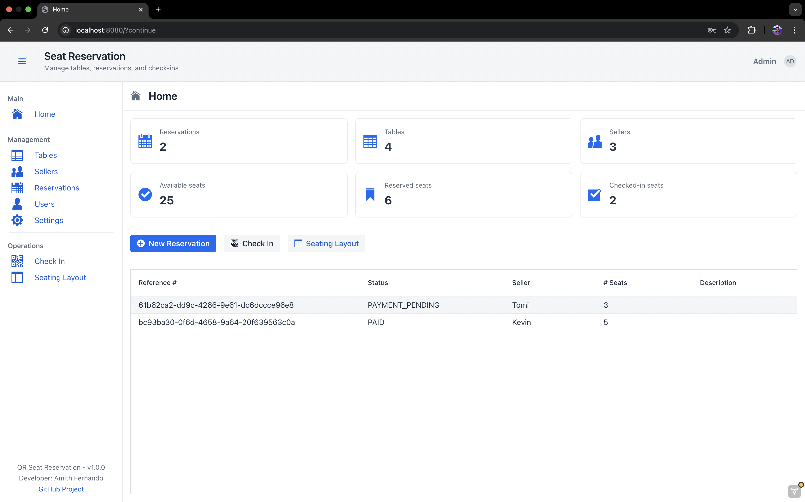
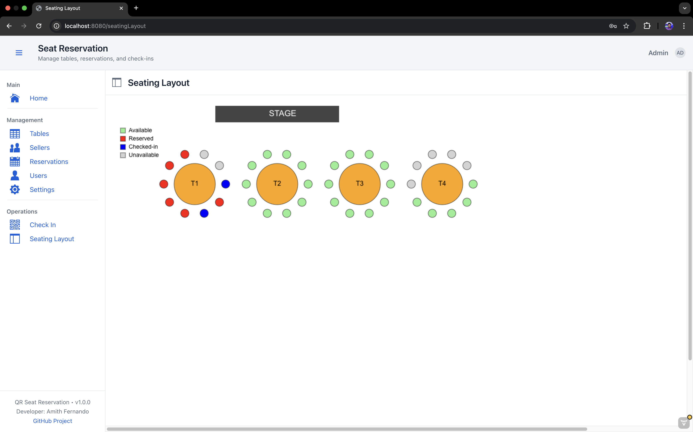

# QR Seat Reservation

A Vaadin Flow + Spring Boot app for managing event seating: tables, reservations, ticket generation, and QR code check-ins. It includes role-based access, an admin-only User Management view, and a clean, user-friendly UI.

## Table of Contents
- Features
- Tech Stack
- QR Tickets & Check-in
- Screenshots
- Quick Start
- Configuration
- Build and Run
- Default Users
- Usage Overview
- Security
- Version & About
- License
- Contributing
- Troubleshooting & FAQ

## Features

- Roles and access control
  - ADMIN: full access (management, settings, users)
  - ENTRANCE: check-in and basic dashboard
- Multi-event
  - Create, activate, archive, and copy events; each user selects the event they work on
  - Tickets, tables, sellers, and settings are kept per event
- Reservations
  - Create, view, and manage reservations
  - Generate ticket numbers (configurable prefix + digit count)
  - FULL/HALF/INVITATION ticket types and ticket categories
- QR tickets
  - Each ticket image carries a QR code of its ticket number, the printed ticket number, and a table/seat label
  - Drag-and-drop Ticket Layout Editor for QR, ticket number, and table/seat positions, sizes, and colors
  - Preview a real ticket before generating; regenerate all ticket images after a layout change
  - Download tickets as a ZIP of images
- Seating
  - Configure tables, seats, and venue zones
  - Visual seating layout and floor layout editor
- Check-in (mobile-first gate screen)
  - Live camera QR scanner (back camera by default, front/back switch)
  - Clear result card: VALID — PAID, ALREADY CHECKED IN (with entry time), or NOT PAID
  - One-tap check-in, undo check-in, and "mark paid & check in" for admins
  - Manual ticket lookup by full or partial number
  - Detects tickets that belong to a different event
  - Recent check-ins list and live stats
- Seller portal
  - Per-seller private link with its own portal password
- Analytics and exports
  - Reports dashboard with financial, seat, check-in, and seller metrics
  - Seller ticket sale export
  - Check-in list export
  - Seller check-in list export
  - Full ticket list export
- Security
  - Spring Security + Vaadin
  - Login view at /login
  - Route-level role annotations
- UI
  - Drawer navigation
  - Header with avatar, username, and friendly logout
  - 404 “Page Not Found” and 403 “Access Denied” error views
- Admin tools
  - User Management (create, edit, enable/disable, set role, reset password)
  - Settings (event metadata, ticket layout, QR/text position, preview)
- Footer
  - Version info (with optional git data) and GitHub link

## Tech Stack

- Java 25, Spring Boot 3.5, Spring Security
- Spring Data JPA (Jakarta), Hibernate
- Vaadin Flow 24.10
- Maven build, npm-managed frontend (Vite)
- QR generation: Nayuki `qrcodegen` (server side)
- QR scanning: `@zxing/library` in a custom `<qr-scanner>` web component (browser camera)
- MySQL 8 (Docker recommended)

## QR Tickets & Check-in

### How a ticket QR works
- The QR code contains **only the ticket number** (for example `DJ000123`), encoded with medium error correction. No personal data is stored in the QR.
- Ticket numbers are `prefix + zero-padded number`; the prefix and number of digits are set per event in **Settings**.
- Ticket images are rendered onto the event's ticket background image with three elements:
  1. QR code
  2. Ticket number text
  3. Table/seat label (optional)

### Designing the ticket
1. **Management → Settings**: upload the ticket background image and set the ticket number format.
2. **Ticket Layout Editor** (`/ticket-layout-editor`, ADMIN): drag the QR, ticket number, and table/seat label onto the ticket.
   - Set QR size and border, font sizes, and text colors (hex, e.g. `#000000`)
   - Use *Snap to grid* and *Match X/Y to QR* to align elements
   - Positions save when you drop an element
3. Click **Preview Real Ticket** to see the exact output.
4. Click **Regenerate All Tickets** so existing ticket images use the new layout.

Default layout values (used until changed in the app) are in `src/main/resources/application.yaml` under `settings.qrImage`.

### Scanning at the gate
Open **Check In** (`/checkin`, ADMIN and ENTRANCE) on a phone or tablet:
1. Tap **Start camera** and point the camera at the ticket QR. The phone vibrates when a code is read.
2. A result card shows:
   - **VALID — PAID**: tap **CHECK IN**
   - **ALREADY CHECKED IN**: shows the time the guest entered
   - **NOT PAID**: admins can **Mark paid & check in**; entrance staff send the guest to the organiser
3. Tap **Next ticket** to continue scanning.

Behaviour to know:
- The same code held in front of the camera is not re-processed for a few seconds, and a ticket just checked in at this device is ignored for 8 seconds, so guests don't see a false "already checked in".
- Status is reloaded on every scan, so check-ins made at other gates are always visible.
- A ticket from a different event is reported as such, not as "not found".
- If the camera can't start, type the ticket number (or part of it) in the search box instead.
- Mistakes can be reversed with **Undo check-in**.

### Camera requirements
- Browsers only allow camera access over **HTTPS** (or `http://localhost`). Use the nginx reverse proxy with SSL in production (see `nginx.conf` and `NGINX_SETUP.md`).
- If the camera is blocked, allow it in the browser's site settings and tap **Try again**.
- The camera stops automatically when the page is hidden and restarts when you return.

## Screenshots


Login Page


Home Page


Manage Table


Manage Reservation


Reservation Details


Seating Layout


Check-in Page

## Quick Start

1) Start MySQL (Docker):
```console
foo@bar:~$ docker run --name qr-seat-reservation-db -e MYSQL_ROOT_PASSWORD=root -e MYSQL_DATABASE=qrseat -p 3306:3306 -d mysql:8
```
2) Configure datasource (application.properties):

```properties
 spring.datasource.url=jdbc:mysql://localhost:3306/qrseat?useSSL=false&allowPublicKeyRetrieval=true&serverTimezone=UTC
 spring.datasource.username=root
 spring.datasource.password=root
 spring.jpa.hibernate.ddl-auto=update
``` 

3) Run the app:


Open:
- App: http://localhost:8080/
- Login: http://localhost:8080/login

## Configuration

Common properties (application.properties):
- DB: spring.datasource.url, spring.datasource.username, spring.datasource.password
- JPA Schema: spring.jpa.hibernate.ddl-auto (use update for dev; validate for prod)

Optional version info (git.properties) to enrich footer:
- Add a git properties plugin to include commit/branch/time for builds (optional).

## Build and Run

- Development:
```console
foo@bar:~$ ./mvnw spring-boot:run
```
- Production:
```console
foo@bar:~$ ./mvnw clean package
foo@bar:~$ java -jar target/qr-seat-reservation-*.jar
```


Maven will handle frontend tasks (no manual npm build needed).

## Default Users

Seeded at startup:
- admin / admin123 — ADMIN
- entrance / entrance123 — ENTRANCE

You can change them later in the app.

## Usage Overview

- Select Event (/select-event) — Choose the event to work on
- Home (/) — Dashboard with quick stats and actions
- Events (/events) — Create, activate, archive, and copy events (ADMIN)
- Reservations (/reservations) — Create/manage reservations; download tickets (ADMIN)
- Check In (/checkin) — Scan ticket QR codes with the camera or search manually
- Seating Layout (/seatingLayout) — Visualize seats
- Ticket Layout Editor (/ticket-layout-editor) — Position QR, ticket number, and table/seat label (ADMIN)
- Ticket Categories (/ticket-categories) — Manage ticket categories (ADMIN)
- Floor Layout Editor (/floor-layout-editor) — Arrange tables and zones (ADMIN)
- Reports (/reports) — Metrics and exports (ADMIN)
- Settings (/settings) — Event metadata, ticket number format, ticket background (ADMIN)
- Users (/users) — Admin-only user management
- Seller Portal (/seller-portal/{token}) — Seller's private page, protected by the seller's portal password

## Security

- Login via Vaadin Login Overlay
- Roles enforced with @RolesAllowed on routes
- Separate 404 and 403 error views for clarity

## Version & About

The drawer footer shows:
- Version (Implementation-Version)
- Project maintainers and GitHub project link

## License

QR Seat Reservation

This project includes open source components licensed under the Apache License, Version 2.0.

Vaadin is a registered trademark of Vaadin Ltd. This project is not affiliated with Vaadin Ltd. Vaadin components used by this project are available under the Apache License 2.0 (unless otherwise noted by their respective packages).

Copyright (c) 2025 QR Seat Reservation Contributors

Note: Vaadin Pro components (if used) require a separate commercial license.

## Contributing

- Fork the repo and create a feature branch
- Keep commits clean; add tests when possible
- Open a PR describing the change and motivation

## Troubleshooting & FAQ

- “Can’t configure requestMatchers after anyRequest”
    - Define only specific matchers in your security config and let Vaadin’s VaadinWebSecurity finalize the chain. Avoid putting anyRequest() before Vaadin’s configuration.
- Login redirect loops
    - Ensure /login is permitAll and protected routes use @RolesAllowed.
- MySQL connection issues
    - Check Docker is running, credentials match, and serverTimezone is set in the JDBC URL.
- QR camera access denied
    - Use HTTPS or allow camera access in the browser. Follow browser prompts to grant camera permissions.
- "The camera is busy"
    - Another app or browser tab is using the camera. Close it and tap Try again.
- Scanned ticket shows "not found"
    - Make sure the correct event is selected. Tickets generated before a ticket number format change may need regenerating.
- QR prints but won't scan
    - Increase the QR size or border in the Ticket Layout Editor, keep it on a light background, and regenerate tickets.

Happy building!

